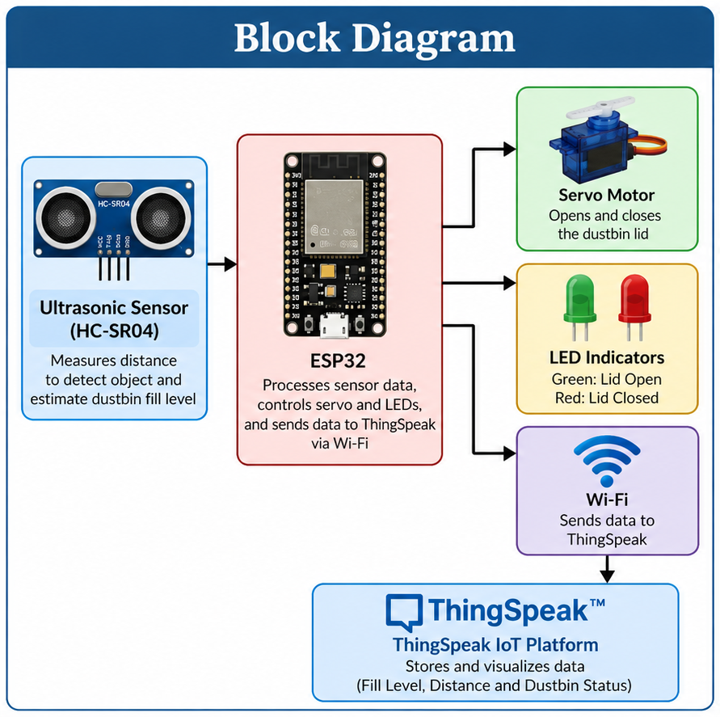
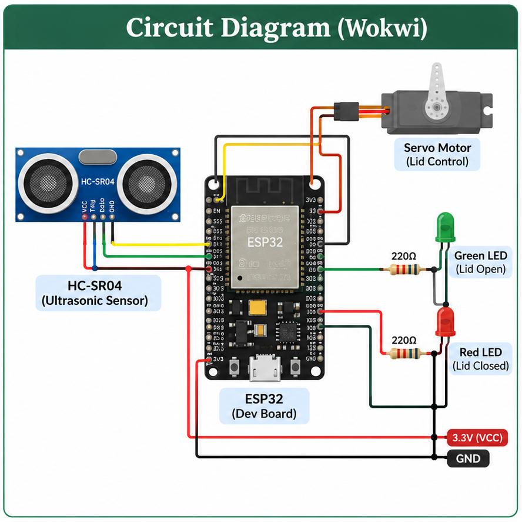
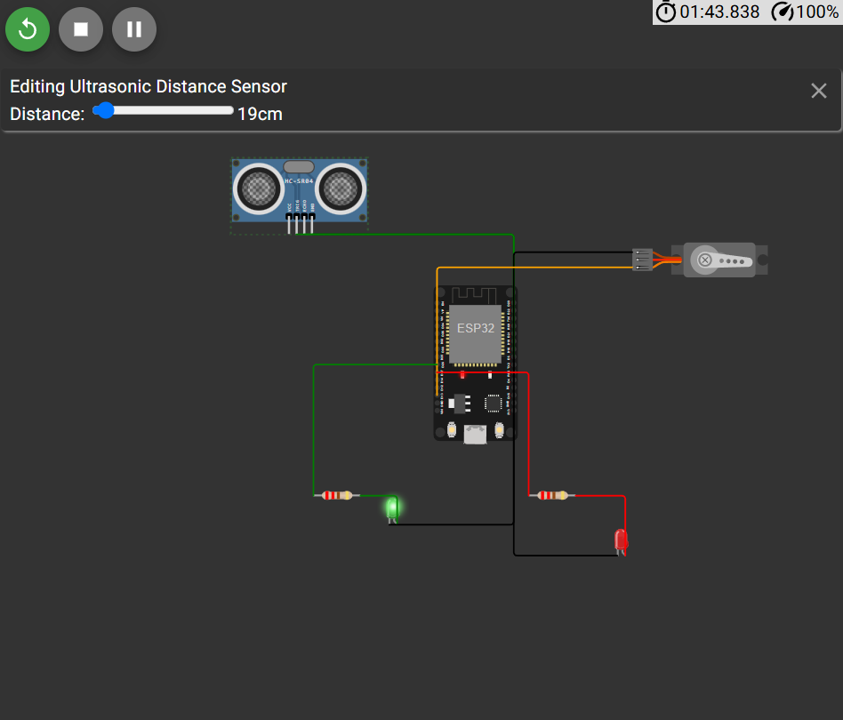
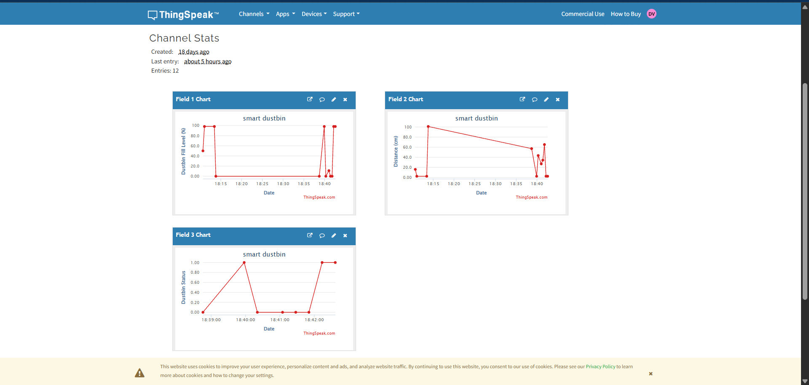

# Smart Dustbin IoT Project 🚮

An IoT-based Smart Dustbin using ESP32, an HC-SR04 ultrasonic sensor, a servo motor, and LEDs. The system automatically opens and closes the dustbin lid based on detected distance and uses ThingSpeak to visualize sensor data remotely.

## 1. Project Overview

The Smart Dustbin project demonstrates how embedded systems and the Internet of Things (IoT) can improve hygiene and waste management. An ESP32 reads distance measurements from an ultrasonic sensor and controls a servo motor to automate the lid. Sensor readings and status values can be monitored through a ThingSpeak dashboard.

## 2. Problem Statement

Traditional dustbins often require users to touch the lid, which can be unhygienic. Manual monitoring also makes it difficult to track dustbin conditions. This project demonstrates touch-free lid operation and cloud-based monitoring to help address these problems.

## 3. Objectives

- Develop an automatic, touch-free dustbin lid.
- Measure object distance using an ultrasonic sensor.
- Control the lid using a servo motor.
- Use LEDs to indicate system status.
- Send sensor readings to ThingSpeak for remote visualization.
- Understand the integration of ESP32, MicroPython, and IoT services.

## 4. Components Required

| Component | Purpose |
|---|---|
| ESP32 development board | Main controller and Wi-Fi connectivity |
| HC-SR04 ultrasonic sensor | Measures distance |
| Servo motor | Opens and closes the lid |
| Green LED | Indicates the configured green status |
| Red LED | Indicates the configured red status |
| Resistors | Limit LED current |
| Jumper wires | Electrical connections |
| Wokwi | Circuit simulation |
| ThingSpeak | IoT data visualization |
| GitHub | Project documentation and source control |

## 5. Software and Technologies

- MicroPython
- Wokwi online simulator
- ESP32
- ThingSpeak IoT platform
- Git and GitHub

## 6. Block Diagram

The system follows this basic architecture:

**HC-SR04 Ultrasonic Sensor → ESP32 → Servo Motor and LEDs**

**ESP32 → Wi-Fi → ThingSpeak Dashboard**

The ultrasonic sensor supplies distance measurements to the ESP32. The ESP32 controls the servo and LEDs according to the program logic. It can also transmit monitoring data to ThingSpeak over Wi-Fi.

## 7. Circuit Diagram and Pin Connections

The circuit connects the ultrasonic sensor, servo motor, and two LEDs to the ESP32.

| Component pin | ESP32 connection |
|---|---|
| HC-SR04 VCC | 5V/VIN |
| HC-SR04 GND | GND |
| HC-SR04 TRIG | GPIO 5 |
| HC-SR04 ECHO | GPIO 18 |
| Servo signal | GPIO 13 |
| Servo V+ | 5V supply |
| Servo GND | GND |
| Green LED anode through resistor | GPIO 26 |
| Red LED anode through resistor | GPIO 27 |
| LED cathodes | GND |

Verify these connections against the final Wokwi `diagram.json` before submission.

**Hardware safety:** The HC-SR04 ECHO signal may be 5V. For a physical ESP32, use an appropriate voltage divider or level shifter to reduce the signal to a safe 3.3V level. A servo may require a separate suitable power supply with a common ground.

## 8. Working Principle

1. The ESP32 initializes the ultrasonic sensor, servo motor, and LEDs.
2. The ultrasonic sensor measures the distance to an approaching object.
3. The ESP32 compares the measurement with the programmed threshold.
4. If the object is within the configured range, the servo opens the lid.
5. The program closes the lid according to its timing and control logic.
6. The LEDs indicate the programmed system state.
7. When Wi-Fi and ThingSpeak communication are configured, sensor readings and status data are transmitted to the cloud for visualization.

## 9. Program Explanation

The main program is stored in `main.py`.

- **Pin initialization:** Configures the trigger, echo, servo, and LED GPIO pins.
- **Distance measurement:** Sends an ultrasonic pulse and measures the echo duration.
- **Distance calculation:** Converts the measured pulse duration into an approximate distance in centimetres.
- **Servo control:** Uses PWM to position the servo and operate the lid.
- **LED control:** Switches the LEDs according to the program's conditions.
- **IoT monitoring:** Sends configured field values to ThingSpeak through a Wi-Fi connection.

The actual threshold, timing, and LED meanings are determined by the final `main.py` implementation.

## 10. Output and Results

The project is simulated in Wokwi to verify the circuit and program behaviour. The ultrasonic sensor distance can be changed in the simulator to test lid operation.

### Wokwi Simulation Output

### ThingSpeak Monitoring Dashboard

The ThingSpeak channel contains three configured graphs:

- **Field 1 — Dustbin Fill Level (%):** The value reported by the program as the estimated fill level.
- **Field 2 — Distance (cm):** The measured distance in centimetres.
- **Field 3 — Dustbin Status:** The numerical status value sent by the program. In the current configuration, `0` and `1` represent the two lid states as defined by the code.

These values depend on the data transmitted by the program. The fill-level graph represents an estimate, not a direct measurement of actual waste volume.

## 11. Applications

- Homes and apartments
- Schools and colleges
- Offices and workplaces
- Hospitals and public facilities
- Smart-city waste management prototypes
- IoT and embedded-systems education

## 12. Advantages and Limitations

### Advantages

- Reduces the need to touch the dustbin lid.
- Demonstrates automated control using an ultrasonic sensor.
- Enables remote visualization of sensor readings.
- Provides practical experience with ESP32 and MicroPython.
- Can be extended with alerts and additional sensors.

### Limitations

- Ultrasonic measurements can fluctuate due to sensor placement and object shape.
- The current prototype does not independently verify the actual volume of waste.
- ThingSpeak monitoring requires successful network communication.
- The simulated setup may behave differently from physical hardware.
- The servo and power supply must be selected appropriately for a real dustbin lid.

## 13. Future Scope

- Send notifications when the dustbin reaches a calibrated fill threshold.
- Improve fill-level accuracy with appropriate sensor placement and calibration.
- Add a mobile-friendly dashboard.
- Monitor multiple dustbins from a central dashboard.
- Add battery monitoring and low-power operation.
- Test the system using physical hardware and a real dustbin.

## 14. Team Details, Project Links, and References

### Team Details

**Project Title:** Smart Dustbin IoT Project

**Team Members:**

1. Dinah.V
2. Deepika.M
3. Sandhya.K
4. Muvitha.M
5. Srimathi.S

**Department:** BCA B SEC

**College:** St. Francis de Sales College (Autonomous)

**Academic Year:** 2026–2027

### Project Links

- **GitHub Repository:** [Smart Dustbin IoT Project](https://github.com/dinah0006/Smart-DustBin)
- **Wokwi Simulation:** [View Smart Dustbin Simulation](https://wokwi.com/projects/475963023334297601)
- **ThingSpeak Channel:** [View ThingSpeak Dashboard](https://thingspeak.mathworks.com/channels/3506250)
- **Project Report:** `report/smart-dustbin-report.pdf`

### References

- [Wokwi ESP32 Simulator](https://wokwi.com/)
- [ThingSpeak IoT Platform](https://thingspeak.mathworks.com/)
- [MicroPython Documentation](https://docs.micropython.org/)
- [Espressif ESP32 Documentation](https://docs.espressif.com/projects/esp-idf/en/stable/esp32/)

---

This project is developed for educational purposes to demonstrate IoT monitoring, embedded programming, and automation using an ESP32.
